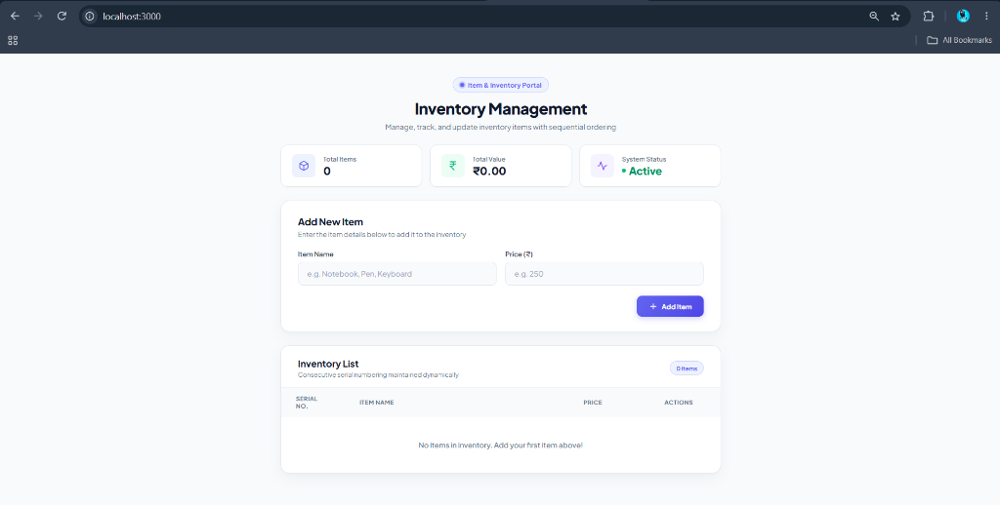
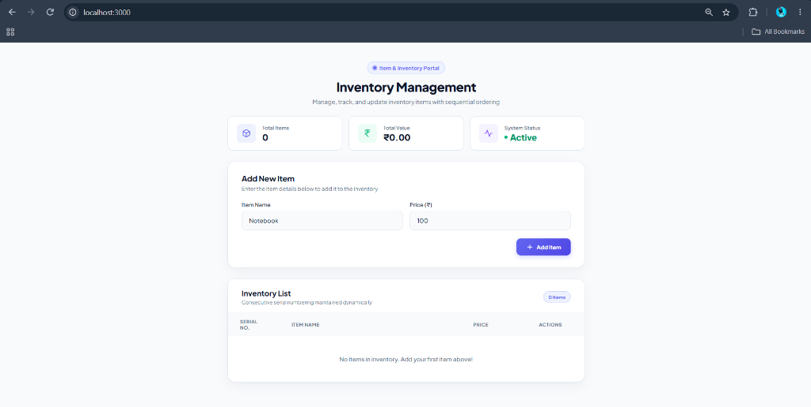
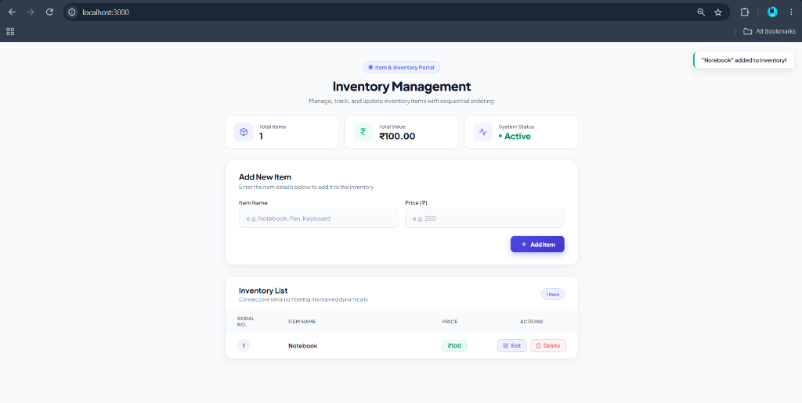
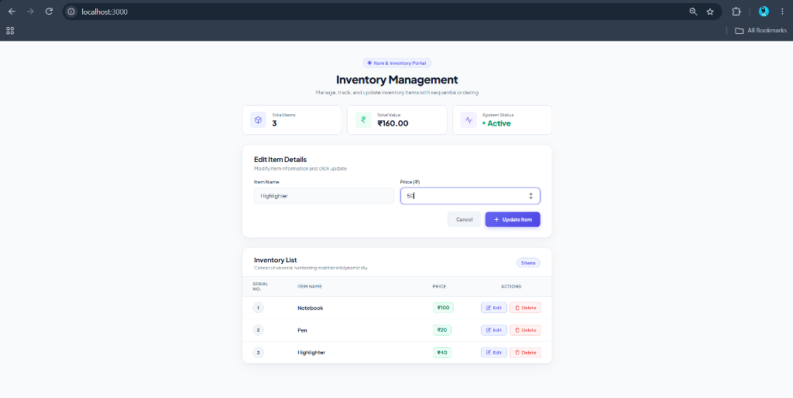
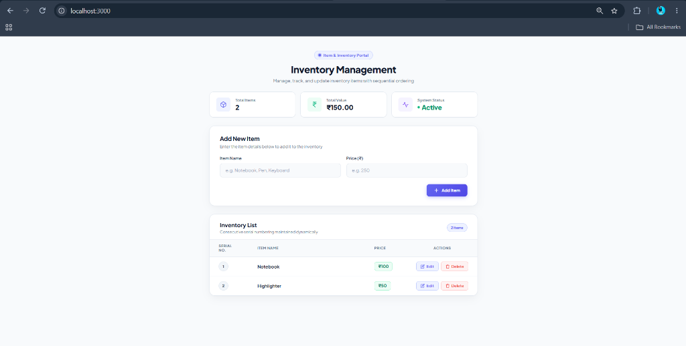

##  Output 

### Figure 1: Starting Phase
The initial state of the application on page load with the input form ready and the empty inventory table.

---

### Figure 2: While Adding Items
Entering a new item's details (`Name: Notebook`, `Price: 100`) into the form fields.

---

### Figure 3: Items Added
The item is successfully created via `POST /items` and dynamically rendered in the table starting with Serial No. 1.

---

### Figure 4: Updating Item's Price
Clicking the "Edit" button populates the form with existing values; updating the price of `Highlighter` to `50` and submitting via `PUT /items/:id`.

---

### Figure 5: Deleting Items from List
Clicking the "Delete" button removes an item (`Pen`) from the list via `DELETE /items/:id`, automatically re-sequencing remaining items to maintain strict consecutive Serial Numbers (1, 2) without gaps.

